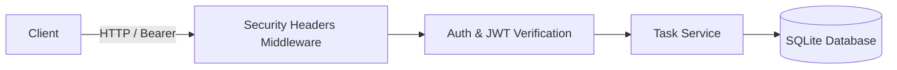

# TaskForge

Defensive task management REST API implementing zero-trust tenant boundaries and custom cryptographic primitives.

[](https://github.com/AliSaleh07/TaskForge/actions/workflows/ci.yml)
[](https://taskforge.salehsec.dev/docs)

## Live Deployment

- **Interactive API Documentation (Swagger)**: [https://taskforge.salehsec.dev/docs](https://taskforge.salehsec.dev/docs)
- **Service Health Check**: [https://taskforge.salehsec.dev/healthz](https://taskforge.salehsec.dev/healthz)
- **Alternative ReDoc Docs**: [https://taskforge.salehsec.dev/redoc](https://taskforge.salehsec.dev/redoc)

## Core Engineering

- **Tenant Isolation**: Tasks are strictly partitioned by authenticated user ID. Cross-tenant access attempts return `404` to avoid leaking resource existence.
- **Cryptographic Security**: PBKDF2-HMAC-SHA256 password hashing (600,000 iterations, 32-byte salt). HMAC-SHA256 JWT validation using constant-time comparison.
- **Defensive HTTP Headers**: Enforces HSTS, CSP, and strict framing policies (`DENY`, `nosniff`).
- **Input Sanitization**: Parameterized SQLite queries and strict Pydantic schemas.
- **Production Validation**: Fails fast at startup if `TASKFORGE_SECRET_KEY` is missing, short, or matches insecure defaults; enforces non-localhost CORS origins in production.



## Quickstart

```bash
python -m venv .venv
source .venv/bin/activate  # On Windows: .venv\Scripts\activate
pip install -r requirements.txt
uvicorn taskforge.main:app --reload
```

## Running Tests

```bash
pytest -v tests/
```

## Production Docker Deployment

```bash
docker build -t taskforge:latest .
docker run -d \
  -p 8000:8000 \
  -e TASKFORGE_ENV=production \
  -e TASKFORGE_SECRET_KEY="<cryptographically-secure-32+-char-secret>" \
  -e TASKFORGE_ALLOWED_ORIGINS="https://dashboard.salehsec.dev,https://salehsec.dev" \
  -e TASKFORGE_DATABASE_PATH="/app/data/taskforge.db" \
  -v taskforge_data:/app/data \
  taskforge:latest
```

## Endpoints

- `GET /` - Service welcome and documentation discovery
- `GET /healthz` - Liveness and readiness health probe
- `POST /api/v1/auth/register` - Create account (enforces complexity rules)
- `POST /api/v1/auth/login` - Obtain signed JWT
- `GET /api/v1/auth/me` - Profile lookup
- `GET /api/v1/tasks` - List tasks (supports `status`, `priority`, `search`, pagination)
- `POST /api/v1/tasks` - Create task
- `GET /api/v1/tasks/{id}` - Fetch single task
- `PUT /api/v1/tasks/{id}` - Update task details
- `DELETE /api/v1/tasks/{id}` - Delete task
- `GET /api/v1/tasks/stats/summary` - Aggregate metrics
